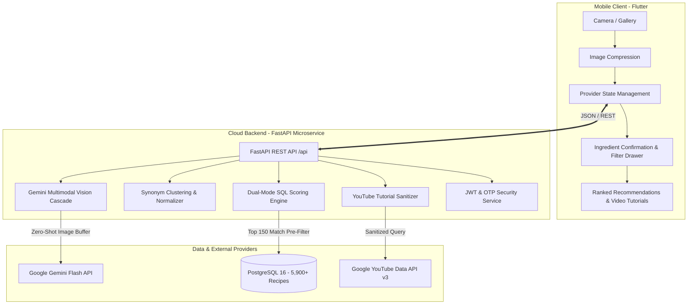
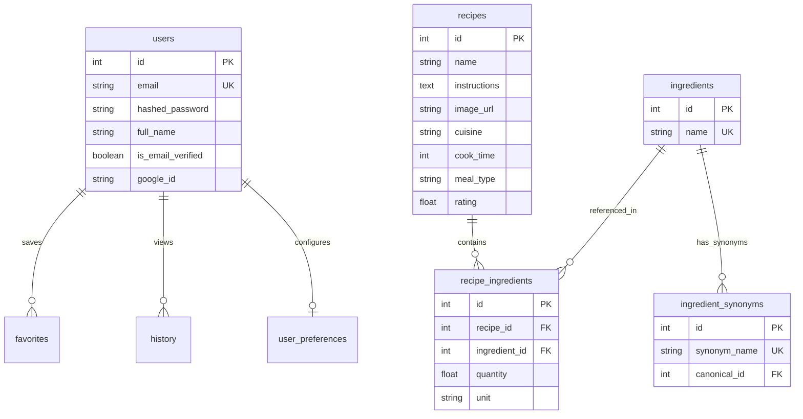

# SmartCook: Master System Architecture & Operational Guide 🍳

An authoritative reference document covering SmartCook's system architecture, AI pipeline, update mechanics (zero-APK vs. APK-required), recipe scoring algorithms, database schema, and operational setup.

---

## 1. Executive Summary & Core Philosophy

**SmartCook** is an end-to-end multimodal AI platform designed to minimize household food waste and resolve meal decision fatigue. Users photograph their pantry or refrigerator; computer vision detects raw ingredients, normalizes regional synonyms, bypasses kitchen staples, and searches across **5,900+ recipes in ~1.15 seconds** using a dual-mode SQL and mathematical scoring engine.



---

## 2. Zero-APK Update Matrix: What Can Be Changed Without a New Build

Because SmartCook uses a decoupled client-server architecture, **the majority of the app's intelligence, ranking formulas, dataset, and AI models live in the cloud and can be updated instantly with zero APK redeployment.**

| Component / Layer | Updatable Without New APK? | Mechanism / Location |
| :--- | :---: | :--- |
| **AI Vision Prompts & Logic** | ✅ **YES** | Edit `backend/app/services/gemini_service.py` |
| **Gemini Model Cascades & Failover** | ✅ **YES** | Edit `candidate_models` list in `gemini_service.py` |
| **Recommendation Ranking Weights** | ✅ **YES** | Adjust scoring formulas in `backend/app/services/recommendation_engine.py` |
| **Pantry Staples Knowledge Base** | ✅ **YES** | Update `PANTRY_STAPLES` set (70+ items) in `recommendation_engine.py` |
| **Synonyms & Regional Dialects** | ✅ **YES** | Expand `SYNONYM_GROUPS` in `recommendation_engine.py` |
| **Recipe Database & Ingredients** | ✅ **YES** | Insert / update records in PostgreSQL (`recipes`, `recipe_ingredients`) |
| **Recipe Instructions & Images** | ✅ **YES** | Update `instructions` or `image_url` fields in PostgreSQL |
| **YouTube Clickbait Filters** | ✅ **YES** | Edit `EXCLUDED_TERMS` in `backend/app/services/youtube_service.py` |
| **Authentication & OTP Delivery** | ✅ **YES** | Configure SMTP/Twilio in `backend/app/config.py` and `otp_service.py` |
| **Backend Host / Server IP** | ✅ **YES** | Built-in in-app **Server Configuration Dialog** (`server_config_dialog.dart`) |
| **Flutter UI Layouts & Widgets** | ❌ **NO** | Hardcoded Dart code in `frontend/flutter_app/lib/screens/` |
| **App Theme, Colors & Typography** | ❌ **NO** | Defined in `frontend/flutter_app/lib/theme/app_theme.dart` |
| **Hardcoded Cuisine / Time Filters** | ❌ **NO** | Static arrays in `ingredient_confirmation_screen.dart` |
| **Native Device Hardware / Permissions** | ❌ **NO** | `AndroidManifest.xml` and native plugins in `pubspec.yaml` |

> **Note on Built-In Server Switching:**
> The Flutter client already includes an in-app IP/domain manager (`server_config_dialog.dart`). If the backend moves from Render (`https://smartcook-api-y1sk.onrender.com`) to AWS, another host, or a local network IP (`http://192.168.x.x:8000`), users can update the endpoint in-app without downloading a new APK.

---

## 3. Architectural Deep Dive: Gemini AI Vision vs. RAG

### Did SmartCook Use RAG for Gemini?
**No. Retrieval-Augmented Generation (RAG) is not used for Gemini in this project.**

```mermaid
flowchart LR
    subgraph Zero-Shot Vision [Actual SmartCook Pipeline]
        Img[Raw Camera Image] --> FastAPIGW[/api/ingredients/detect]
        FastAPIGW -->|Image Bytes + Strict Prompt| Gemini[Gemini Flash API]
        Gemini -->|JSON: name + confidence| JSONOut[Confirmed Ingredients List]
        JSONOut -->|SQL Candidate Pre-Filter| Postgres[(PostgreSQL Database)]
        Postgres --> MathRank[Mathematical Ranking Engine]
    end

    subgraph Hypothetical RAG [Why RAG Was Rejected]
        RAGImg[Query / Image] -.-> VecDB[(Vector DB Embeddings)]
        VecDB -.-> TopDocs[Chunks of 5,900 Recipes]
        TopDocs -.-> BigPrompt[LLM Context Window]
        BigPrompt -.-> LLMGen[LLM Recipe Generator]
    end
```

### Why Gemini is Used Solely for Zero-Shot Computer Vision:
1. **Raw Ingredient Detection (`gemini_service.py`)**:
   * Gemini Flash processes user-uploaded photos (`multipart/form-data`) alongside a single zero-shot prompt.
   * It identifies produce, dairy, proteins, and groceries, returning a clean JSON array of names and confidences.
   * **Fail-Fast Cascading Fallback**: Iterates through prioritized models (`gemini-3.1-flash-lite` → `gemini-3.6-flash` → `gemini-3-flash-preview` → `gemini-3.5-flash` → `gemini-3.8-flash`) with a 10s per-model timeout to bypass 429 rate limits.
2. **Why RAG Was Rejected for Recipe Retrieval**:
   * **Zero Hallucination Guarantee**: Cooking steps, missing ingredient counts, and measurements must be exact. Mathematical set operations in SQL + Python guarantee 100% truth.
   * **Latency (1.15s vs. 6–10s)**: Querying PostgreSQL directly takes ~1.15 seconds across 5,900+ recipes; an LLM-based RAG cycle would add several seconds of network and generation overhead.
   * **API Quota & Cost**: Avoiding thousands of prompt tokens on every recipe search reserves Gemini API quotas exclusively for vision tasks.

---

## 4. Recommendation & Scoring Algorithms

SmartCook's ranking engine (`backend/app/services/recommendation_engine.py`) operates in two distinct stages:

### Stage 1: Indexed SQL Candidate Pre-Filter (< 0.20s)
Instead of deserializing all 5,900+ recipes through an ORM, the engine expands search terms with synonyms and executes an indexed subquery:
```sql
SELECT recipe_ingredients.recipe_id, COUNT(recipe_ingredients.ingredient_id) AS match_count
FROM recipe_ingredients
JOIN ingredients ON recipe_ingredients.ingredient_id = ingredients.id
WHERE ingredients.name IN (:expanded_terms) OR ingredients.name ILIKE ANY(:patterns)
GROUP BY recipe_ingredients.recipe_id
ORDER BY match_count DESC
LIMIT 150;
```
This narrows the candidate search space by **97.5%**, completely preventing memory serialization bottlenecks.

### Stage 2: Dual-Strategy Mathematical Scoring
Candidates are evaluated based on user-selected modes:

#### 1. Basket Maximization Mode (Zero Waste)
Prioritizes recipes that use up as many of the user's available groceries as possible:
$$\text{Score} = (0.55 \times \text{BasketCoverage}) + (0.45 \times \text{CorePrecision}) - \text{MissingCorePenalty}$$

#### 2. Ready-to-Cook Mode (Instant Cooking)
Prioritizes recipes that can be prepared immediately with the fewest missing items:
$$\text{Score} = (0.30 \times \text{BasketCoverage}) + (0.70 \times \text{CorePrecision}) - (1.5 \times \text{MissingCorePenalty})$$

#### Key Definitions:
* **$\text{BasketCoverage}$**: $\frac{\text{User Ingredients Used}}{\text{Total Available Ingredients}}$
* **$\text{CorePrecision}$**: $\frac{\text{Matched Core Ingredients}}{\text{Total Recipe Core Ingredients}}$
* **Pantry Staple Bypass**: 70+ essential seasonings, oils, salts, and aromatics are classified under `PANTRY_STAPLES`. Missing pantry staples **do not trigger missing-core penalties**.

---

## 5. YouTube Tutorial Pipeline (`youtube_service.py`)

* **Query Sanitization**: Strips redundant words ("recipe", "recipes") and joins clean names with focused suffixes: `"{name} recipe tutorial"`.
* **Clickbait & Medical Filter**: Completely excludes videos containing health/remedy keywords:
  ```python
  EXCLUDED_TERMS = {
      'thyroid', 'diabetes', 'disease', 'symptoms', 'treatment', 'doctor',
      'clinic', 'cure', 'blood pressure', 'supplement', 'weight loss',
      'dr.', 'medicine', 'health benefits', 'cancer', 'remedy', 'remedies',
      'deficiency', 'side effect', 'side effects', 'diagnosis'
  }
  ```
* **Culinary Relevance Scoring**: Heavily weights title keyword matches (+5 points), cooking terms ("how to make", "masala", "curry") (+3 points), and core ingredients (+1 point).

---

## 6. Database Schema Summary (PostgreSQL)



---

## 7. Future-Proofing: Unlocking 100% Zero-APK Updates

To avoid needing new APK builds for frontend changes in future iterations:

1. **Server-Driven Configuration Endpoint (`/api/config`)**:
   * Move hardcoded lists in `ingredient_confirmation_screen.dart` (`_cuisineOptions`, `_mealTypeOptions`, `_timeOptions`) into a FastAPI endpoint.
   * The app fetches these options dynamically on startup, allowing you to add cuisines and filters without client rebuilds.
2. **Shorebird Code Push (Over-The-Air Dart Updates)**:
   * Integrating [Shorebird](https://shorebird.dev) allows you to push Flutter Dart code, layout tweaks, and UI bug fixes directly over the air to installed APKs.
3. **Dynamic Home Feed (`/api/home`)**:
   * Serve home screen cards, featured dishes, and seasonal banners via backend JSON to rotate content dynamically.

---

## 8. Operational Cheatsheet & Key Commands

### Backend Initialization & Startup
```bash
cd backend

# 1. Activate Virtual Environment
source venv/bin/activate  # Windows: venv\Scripts\activate

# 2. Run Database Migrations
python migrate_db.py

# 3. Seed Recipes Dataset (5,900+ entries)
python import_dataset.py

# 4. Start Local API Server
uvicorn app.main:app --host 0.0.0.0 --port 8000 --reload
```

### Flutter Mobile Client
```bash
cd frontend/flutter_app

# 1. Fetch Dependencies
flutter pub get

# 2. Run on Connected Device / Emulator
flutter run

# 3. Build Production Release APK
flutter build apk --release
```
The output APK is generated at:
`frontend/flutter_app/build/app/outputs/flutter-apk/app-release.apk`
